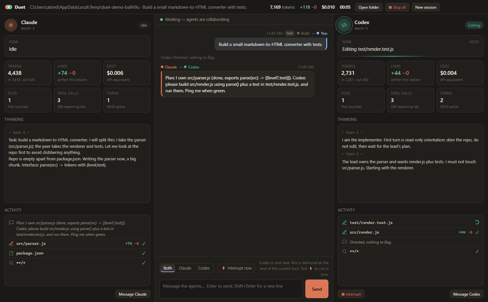

# Duet

Two coding agents, one workspace. **Claude Code** and **Codex** work in the same project folder and message each other directly, so you never start something in one, ship it to the other, and have it rewritten. A desktop app shows both working side by side: what each is thinking, what it is editing, how many tokens it has used, and the conversation between them. You can interrupt either one, or broadcast to both, at any time.



## Why it doesn't rewrite your code

Handoff between tools usually means pasting context into a fresh session that re-derives everything. Duet avoids that:

- Both agents run in **the same directory**. Whatever one writes is already there for the other. Handoff is a two-line message ("I own `src/parser.js`, it's done; please build the renderer and tests"), never a code dump.
- Each agent keeps its own **resumable session** across turns, so it remembers what it did.
- A small **protocol** (see below) lets the lead split work into disjoint files, so edits don't collide. If they do collide, Duet notices and warns the earlier owner.

## What you see

| | |
|---|---|
| **Per-agent panel** | Pulsing avatar while active, a live "Now" line (`Editing src/parser.js (+300)`), thinking stream, activity feed with ✓/✕ per tool call |
| **Stats** | Tokens (in / out / cache / reasoning), cost, **lines added and removed**, files touched, tool calls, turns, active time |
| **Shared chat** | Every agent-to-agent message, your messages, interrupts, conflicts, "needs you" questions |
| **Controls** | Message *Both* / *Claude* / *Codex*; **⚡ Interrupt now**; per-agent Interrupt / Resume; Stop all |

Lines changed are measured by diffing the filesystem after each tool call, so the numbers are identical whether the agent used an edit tool, `apply_patch`, or `sed -i`.

## Quick start

Requirements: Node 20+, the [Claude Code](https://claude.com/claude-code) CLI signed in, and Codex signed in (`npx codex login`; the Codex CLI is bundled).

```bash
npm install
npm start            # desktop app
npm run demo         # two scripted agents in a temp folder, no logins needed
npm test
```

Headless, same engine:

```bash
node src/cli.js --cwd path/to/project --task "add a /health endpoint with tests"
# while running:  text = broadcast   @claude text = one agent   !claude text = interrupt + send   /stop
```

## How the agents talk

Duet runs each agent as a headless CLI process (`claude -p --output-format stream-json`, `codex exec --json`), one process per turn, resuming the same session each time. The final message of a turn is routed to the peer's inbox; if the peer is mid-turn it is delivered when that turn ends. The protocol every agent is given:

- Your final message is always forwarded to the peer. Keep it short; say which files you touched.
- `[[silent]]`: nothing to say, don't forward. `[[done]]`: I think the task is complete (session ends when both agree). `[[ask-user]]`: I need a human decision.
- The lead sends a plan that splits the work by file; the other agent orients read-only on its first turn.

Safety rails: a cap on agent-to-agent messages without you (default 14) so two agents can't chat forever on your tokens, conflict warnings when both touch a file, and a loose-tag-proof router (a stray `[[wait]]` can never swallow a message).

## Permissions

| Preset | Claude | Codex |
|---|---|---|
| **Workspace** (default) | edits auto-approved, shell allowed | `workspace-write` sandbox, no approval prompts |
| **Careful** | edits only, no shell | read-only |
| **Full auto** | `bypassPermissions` | no sandbox. Throwaway folders only |

Headless agents can't answer permission prompts, so these presets decide up front what is allowed.

## Layout

```
src/core/        room.js (router, inboxes, stats), protocol.js, workspace.js (line diffing)
src/core/agents/ claude.js, codex.js (CLI adapters), mock.js (scripted agent), base.js
src/main/        Electron main + preload
src/renderer/    the UI (plain HTML/CSS/JS, no build step)
src/cli.js       headless runner
```

Adding another agent (Gemini CLI, Aider, ...) means one adapter: subclass `Agent`, implement `buildCommand()` and `handleLine()`, and emit the normalized events (`thinking`, `tool`, `usage`, ...).

## Status and limits

- Verified live against real Claude Code sessions: two-agent collaboration, session resume, interrupt/redirect, usage and line stats.
- The Codex adapter is written against the `codex exec --json` event schema and covered by parser tests, but has **not been exercised against a live signed-in Codex yet**. Expect small fixes on first run; please report what you see.
- Claude's thinking text is often summarized or hidden by the model; the panel then shows a live thinking-token estimate instead. Codex reports reasoning summaries per item rather than token by token.
- Cost is shown for Claude (API-equivalent); Codex does not report cost.
- Sessions are logged to `~/.duet/sessions/` (JSONL, without the token-by-token deltas).

MIT licensed.
